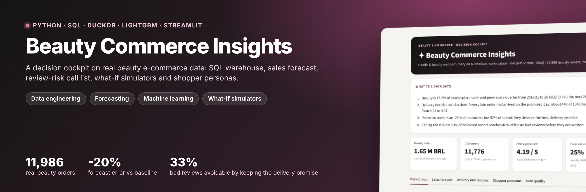
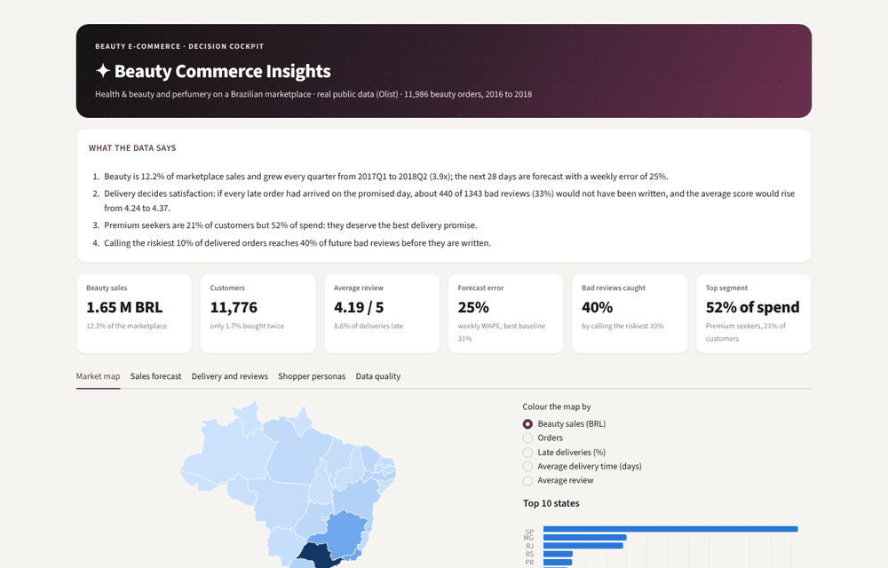
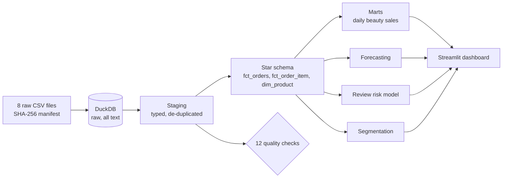
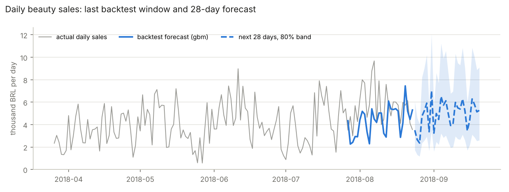
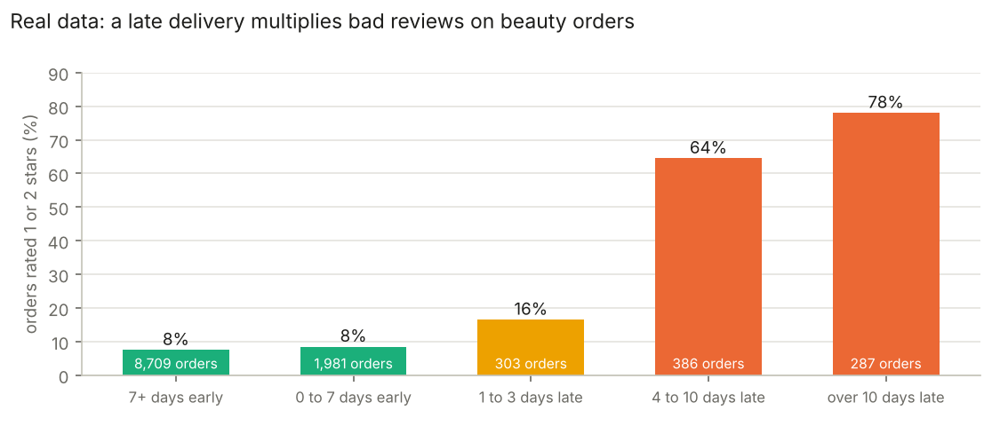
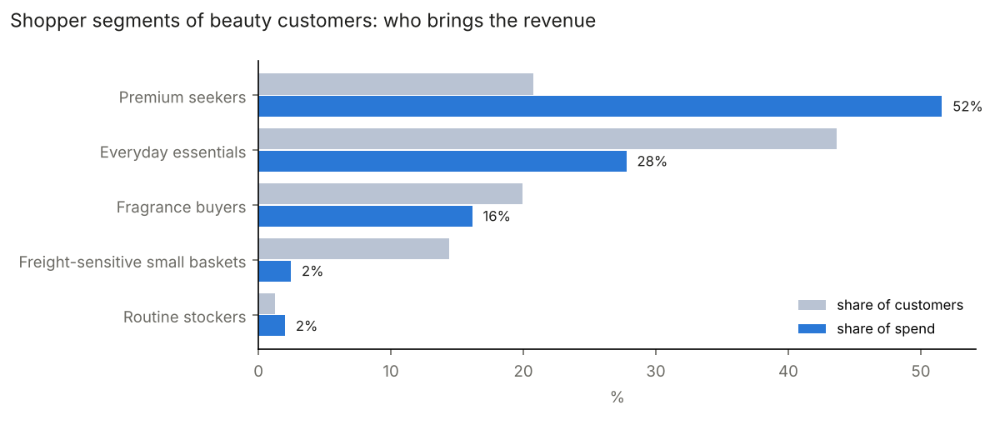
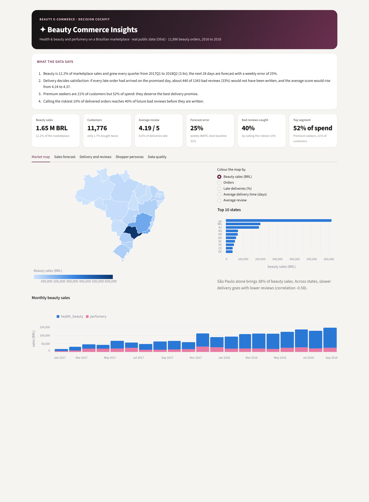
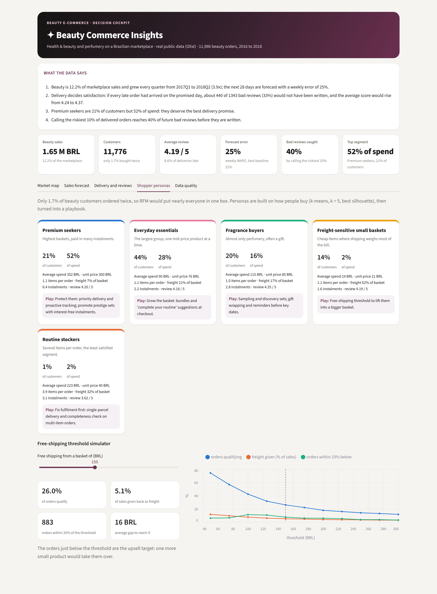
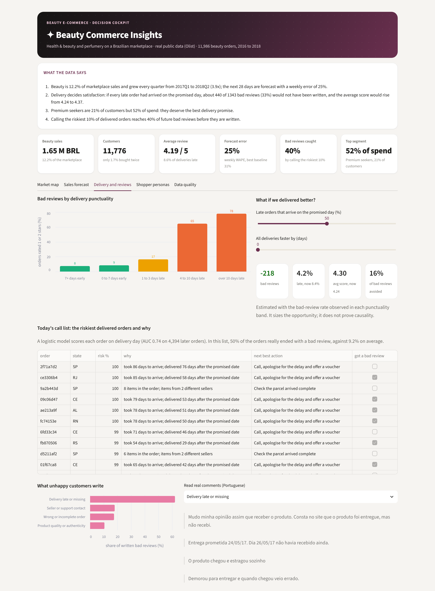
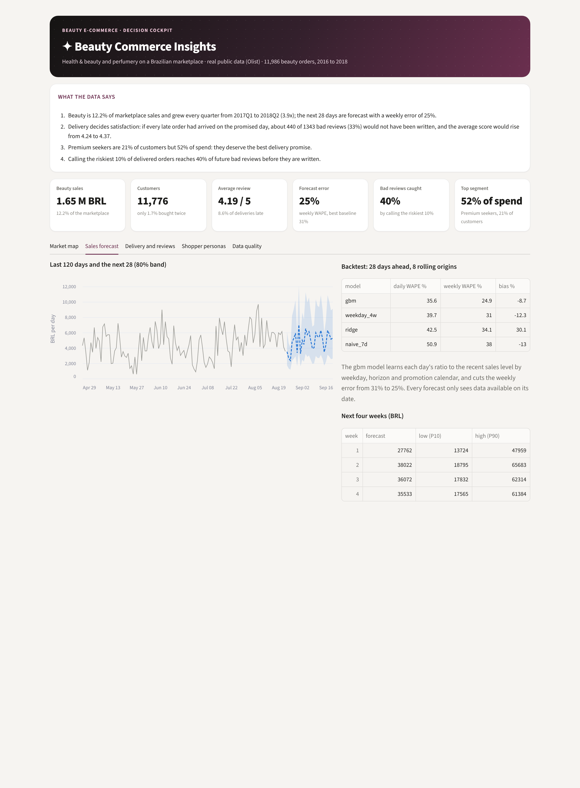

<p align="center"></p>

<p align="center">
  <a href="https://github.com/kawtar-bellamine/beauty-commerce-insights/actions/workflows/tests.yml"></a>
  
  
  
  
</p>

**A decision cockpit on real beauty e-commerce data.** Raw files become a SQL warehouse with quality checks, then a sales forecast, a review-risk model, shopper personas and what-if simulators, all in an interactive dashboard that answers the questions a beauty business team actually asks: *how much will we sell, why do customers leave bad reviews, who should we call today, and what would it be worth to fix delivery?*

The data is the public [Olist](https://github.com/olist/work-at-olist-data) marketplace extract (Brazil, 2016 to 2018, 99,441 orders). Health & beauty and perfumery are its first category by sales: **11,986 beauty orders, 1.65 million BRL, 12.2% of the marketplace**.

<p align="center"></p>

## Four business questions, four answers

| Question | Answer from the data |
|---|---|
| How much will we sell in the next four weeks? | A LightGBM model forecasts daily beauty sales 28 days ahead with a **weekly error (WAPE) of 25%**, against 31% for the best simple baseline: **20% less error**, measured on 8 rolling backtests. |
| What makes a beauty customer unhappy? | Delivery, by far. Orders delivered early get **7.5%** bad reviews; orders more than 10 days late get **78%**. **62%** of written 1 and 2-star reviews talk about delivery. |
| Which orders should customer service call first? | A model scores each order on delivery day. On 4,394 later orders, calling the riskiest **10% reaches 40% of all bad reviews** (AUC 0.74), with a bad-review rate four times the average. |
| Who are the beauty shoppers? | Only **1.7%** ordered twice, so RFM is useless here. Five behaviour-based segments instead: **Premium seekers are 21% of customers but 52% of spend**. |
| What would keeping the delivery promise be worth? | If every late order had arrived on the promised day, about **440 of 1,343 bad reviews (33%)** would not have been written and the average score would rise from **4.24 to 4.37**. |

## 1. Data engineering: a warehouse you can trust



Every file is verified against its checksum, read as text, then typed in SQL (`sql/01_staging.sql`, `sql/02_marts.sql`). Twelve checks run on each build; blocking checks stop the pipeline, warnings are handled in staging. On the real data:

| Check | Result |
|---|---|
| Duplicate orders, orphan items, items without product, delivery before purchase, non-positive prices | **0**, pass |
| Products without a category | 610 (1.9%), labelled `unknown` |
| Orders with several reviews | 547, latest kept |
| Handed to the carrier before payment approval | 1,359 (1.4%), flagged |
| Payments differing from items + freight by more than 1 BRL | 313, flagged |
| Final days of the extract | incomplete: cut automatically before forecasting (orders fall below half the usual level) |

## 2. Sales forecasting



Four models are compared, all trained only on data available at each forecast origin (a test checks that changing the future cannot change a past forecast):

| Model | Daily WAPE | Weekly WAPE | Bias |
|---|---:|---:|---:|
| **LightGBM** on the ratio to the recent level (horizon, weekday, Black Friday calendar) | **35.6%** | **24.9%** | -8.7% |
| Mean of the same weekday over 4 weeks | 39.7% | 31.0% | -12.3% |
| Ridge regression with trend and weekday | 42.5% | 34.1% | +30.1% |
| Same day last week | 50.9% | 38.0% | -13.0% |

The 28-day forecast comes with an 80% band taken from the model's own backtest errors.

## 3. Customer experience and review risk



| Delivery vs promise | Orders | Rated 1 or 2 stars | Average score |
|---|---:|---:|---:|
| 7+ days early | 8,709 | 7.5% | 4.41 |
| 0 to 7 days early | 1,981 | 8.5% | 4.30 |
| 1 to 3 days late | 303 | 16.5% | 3.95 |
| 4 to 10 days late | 386 | 64.5% | 2.22 |
| over 10 days late | 287 | 78.0% | 1.76 |

The review-risk model is trained on orders bought before April 2018 and tested on the months after. Logistic regression (AUC 0.74) edges out LightGBM (0.71); the top drivers are days late versus promise, total delivery time, promised time and freight relative to basket value. Written complaints, grouped by Portuguese keyword rules: delivery 62%, seller or support contact 18%, wrong or incomplete order 18%, product quality or authenticity 11%.

## 4. Shopper segments



| Segment | Customers | Share of spend | Average spend | What defines them |
|---|---:|---:|---:|---|
| Premium seekers | 21% | 52% | 352 BRL | median unit price 300 BRL, about 6 instalments |
| Everyday essentials | 44% | 28% | 90 BRL | single mid-price items |
| Fragrance buyers | 20% | 16% | 115 BRL | almost only perfumery |
| Freight-sensitive small baskets | 14% | 2% | 24 BRL | freight is 62% of the basket |
| Routine stockers | 1% | 2% | 223 BRL | 3.9 items per order, the lowest review score (3.6) |

Segments come from k-means on six purchasing features; k = 5 has the best silhouette score among 3 to 6. Names are given by explicit rules on the segment profile, so they are reproducible.

## 5. Decision tools: from analysis to action

The cockpit does not stop at charts. It opens with **an executive brief written from the numbers** ("what the data says"), and every tab ends with something a team can act on:

| Tool | What it does |
|---|---|
| **Market map** | Brazil coloured by beauty sales, orders, late deliveries, delivery time or average review. São Paulo alone brings 38% of beauty sales; across states, slower delivery goes with lower reviews (correlation -0.58). |
| **Delivery what-if** | Two sliders: share of late orders delivered on time, and days saved on every delivery. Bad reviews avoided, late rate and average score update live, estimated with the bad-review rate observed in each punctuality band. |
| **Today's call list** | The riskiest delivered orders, each with the two reasons that drive its score (from the logistic model's contributions) and a next best action: apology and voucher for long delays, completeness check for multi-seller parcels. Half of the listed orders really ended with a bad review, against 9% on average. |
| **Persona playbook** | One card per segment: who they are, their numbers, and a play (protect premium buyers with priority delivery, grow everyday baskets with bundles, use sampling for fragrance buyers). |
| **Free-shipping simulator** | Pick a basket threshold: share of orders qualifying, freight given back as a share of sales, and the orders just below the threshold that one more product would push over it. At 150 BRL: 26% of orders qualify, 5.1% of sales are given back, and 883 orders sit within 20% of the threshold. |

<table>
<tr><td width="50%"></td>
<td width="50%"></td></tr>
<tr><td></td>
<td></td></tr>
</table>

## Run it

```bash
pip install -r requirements.txt
python experiments/run_all.py     # downloads the data (64 MB, checksummed), builds the warehouse, writes results/
streamlit run app/dashboard.py    # dashboard
pytest -q                         # 15 tests on a committed sample of the real data (5,000 orders)
```

Without the download, the dashboard and the tests run on `data/sample/`, a reproducible extract of the real data.

## Repository map

```
sql/                 staging and star-schema models (DuckDB SQL)
bci/data.py          download, checksums, raw load
bci/quality.py       12 data-quality checks
bci/forecast.py      4 forecasting models and rolling-origin backtest
bci/experience.py    delivery effect, review-risk model, complaint themes
bci/segments.py      behaviour-based shopper segmentation
bci/insights.py      executive brief, delivery what-if, call list, persona playbook, free-shipping simulator
bci/pipeline.py      runs everything once for the study, the dashboard and the tests
app/dashboard.py     Streamlit dashboard
experiments/         full study and figures
```

## Limits

* The data is a Brazilian marketplace from 2016 to 2018, not a brand's own data. Prices are in BRL, and the beauty scope is the marketplace's two beauty categories.
* With a single Black Friday in the history, the forecast cannot learn yearly seasonality; a longer history would be needed.
* The review-risk score uses information known on delivery day. A score at shipping time, before the delay is known, would be more useful and less accurate.
* Complaint themes come from keyword rules in Portuguese, not from a language model: they are transparent but approximate.
* The what-if simulators apply observed rates to new scenarios. They size an opportunity; they do not prove that fixing delivery would cause the change.

## Data and licence

Data: [olist/work-at-olist-data](https://github.com/olist/work-at-olist-data), MIT licence (c) 2019 Olist. Map boundaries: simplified from [click_that_hood](https://github.com/codeforamerica/click_that_hood), MIT licence (c) Code for America, derived from IBGE data. Code: MIT.
